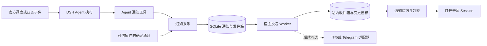

# DSH Agent 主动通知插件设计稿

状态：v0.1.0 实现稿。日期：2026-10-28。

在独立目录 `dsh-agent-notify/` 开发 `@yawenzzz/dsh-agent-notify`。Agent 可在后台主动发送通知，用户在 DSH 的通知栏查看内容、未读状态和来源会话。实现采用官方 DSH 调度与工具接口、SQLite 持久化发件箱及宿主后台投递 Worker，参考 nanobot 的发送与恢复机制。

## 1 交付范围

第一版完成一个 DSH Host 内的完整闭环：Agent 发送、定时唤醒、站内通知栏、未读管理、来源会话跳转、重启恢复。一个 Host 中的多个 Agent 和 Session 共用通知中心。

默认发送到当前 DSH 应用的所有者。浏览器关闭不影响宿主接收和保存通知；重新打开后可以查看未读消息。DSH 进程必须保持运行，主机休眠或进程退出期间不会执行定时检查。

飞书、Telegram 等外部渠道通过独立适配器后续接入。第一版无需配置这些平台的账号。浏览器系统推送和手机离线推送属于外部渠道能力，不能用站内通知代替它们的送达承诺。

### 独立插件与 RSI 的关系

- 单独打包、安装、升级；核心代码不导入 RSI，也不启动另一套 Agent 框架。
- 依赖固定为官方发布的 DSH `0.2.1-rc.3`，保持与当前 RSI 的基线一致；不修改或复制 DSH 运行时。
- 通过官方 `dsh` CLI 和用户选择的 profile 加载，运行数据留在用户数据目录。
- RSI 的管理端与项目端是不同 Host。安装到某个 profile 只覆盖该 Host；项目端需显式安装和启用，管理端安装不会自动传播到既有项目。
- 多 Host 的统一通知栏放在后续中继阶段：项目端先持久化，再把通知交给管理端汇总。其鉴权、来源注册和幂等协议必须独立实现，不能直接扫描其他项目数据库。

## 2 用户看到的通知栏

在左侧栏底部、设置按钮旁增加铃铛和未读角标；侧栏折叠成图标栏时保留图标。macOS 完全隐藏侧栏时，展开侧栏后可访问该入口。

点击铃铛打开右侧通知抽屉，桌面宽度约 400px，窄屏占满可用宽度。抽屉是独立浮层，不改变当前 Session、输入草稿和原生文件／终端右栏的状态。另提供“查看全部”进入完整通知中心。

```text
┌──────────────────────────────────────┐
│ 通知   3 条未读       全部已读     关闭 │
│ [全部] [未读] [需处理]                 │
├──────────────────────────────────────┤
│ ● 研究助手 · 项目 A             10:32 │
│   本周研究报告已完成                  │
│   已生成报告，包含三个待确认结论……    │
│   [展开内容] [打开来源会话]            │
├──────────────────────────────────────┤
│ ● 编码助手 · 项目 B             10:15 │
│   需要你确认下一步                    │
│   两个实现路径已整理，请查看……        │
│   [展开内容] [打开来源会话]            │
├──────────────────────────────────────┤
│   研究助手 · 项目 A             昨天  │
│   巡检发现依赖版本更新                │
│   [展开内容] [打开来源会话]            │
└──────────────────────────────────────┘
```

每条通知显示 Agent 名称、可用的工作区名称、标题、正文摘要、时间、未读标记及消息类型。Agent 身份来自宿主执行上下文，不能由模型自行冒充。消息类型为普通、任务结果、需处理；类型不代替真实的任务执行状态。

交互规则：

- 只打开抽屉或浏览列表不会自动清空未读；展开正文或点击“标为已读”才更新该条消息。
- “全部已读”只覆盖用户本次看到的列表快照，操作期间新到的消息保持未读。
- 通知不自动切换会话、不抢输入焦点。查看来源后，用户在原生聊天中继续回复。
- 会话归档或删除后仍保留通知正文；跳转按原生会话控制器结果处理，不能跳转时说明原因。
- 断网时保留已加载内容并显示连接状态；恢复后补拉遗漏的消息和已读变化。
- 正文先支持文本及受限 Markdown；不渲染原始 HTML、不自动读取本地文件。
- 沿用 DSH 的明暗主题和基础组件，支持键盘导航、Esc 关闭、关闭后焦点返回铃铛。

## 3 Agent 如何主动发送

提供一个工具 `notify_user`，供前台任务、后台任务和定时唤醒的 Agent 使用：

```json
{
  "title": "本周研究报告已完成",
  "body": "已生成报告，包含三个需要你确认的结论。可打开来源会话继续讨论。",
  "category": "result",
  "dedupe_key": "weekly-report:2026-10-28:completed"
}
```

工具参数只描述内容。`hostId`、`agentId`、`sessionId`、所有者、创建时间和来源工具调用标识由宿主填入；`dedupe_key` 只能在该来源范围内生效。标题上限 120 字符，正文上限 16 KiB。正文与身份校验通过、数据库事务提交后，工具返回 `notificationId` 和 `queued`，不宣称用户已经看到。

后台投递成功后，通知进入站内收件箱并增加未读数。工具成功结果保留在原生 Session 日志；插件自己的记录用于通知中心，不重写历史会话，也不冒充人类反馈或审批。

### 三类触发方式

| 方式 | 谁唤醒或提交 | 行为 |
| --- | --- | --- |
| Agent 主动通知 | 正在执行的 Agent 调用 `notify_user` | 独立于最终聊天回复，保存并投递明确的通知 |
| 定时检查 | 官方 `@deepseek-ai/dsh-schedule` | 恢复原 Session 并唤醒 Agent；发现值得关注的结果时调用通知工具 |
| 业务事件 | 其他插件调用宿主通知服务，或提交后续任务 | 已有确定消息可直接投递；需要分析时通过官方 Session 控制器唤醒 Agent |

定时检查复用官方 `schedule_create` 等工具和现有任务管理界面，不再维护一套 Cron。为需要主动通知的检查提供明确指令：有新结论时调用 `notify_user`，没有变化则保持安静。默认不把每个普通聊天回复都复制成通知，也不自动创建持续调用模型的轮询任务。

官方调度的投递回执表示提醒已进入 Session 收件箱，不表示模型执行完成。宿主重启后循环任务只补最近一次错过的发生点；提醒投递与任务状态不是同一事务，存在重复唤醒窗口。插件只能保证自己收件箱的幂等，不能宣称业务任务只执行一次。

## 4 消息如何可靠留存和投递



通知服务在一个事务里写入不可变消息和待投递记录。Worker 独立于模型执行，属于当前 DSH 插件的后台任务，不另起一个网关应用。

站内投递在另一个事务里创建收件箱条目、更新投递结果并递增数据库版本；收件箱对“通知与收件人”建立唯一约束。Worker 中途退出后，可以安全恢复站内投递。

| 状态 | 含义和处理 |
| --- | --- |
| `pending` | 已落盘，等待 Worker |
| `sending` | Worker 已领取，记录领取者；Host 单写入锁提供租约 |
| `sent` | 站内收件箱已提交；外部渠道接入后表示平台已接受 |
| `retry_wait` | 确认未送达的临时失败，等待退避重试 |
| `failed` | 永久失败或超过重试／过期限制，保存失败原因 |
| `unknown` | 仅用于外部渠道：请求可能已送达，等待核实，不盲目重发 |

“已读”单独记录为 `readAt`，不会把 `sent` 当作用户已读。外部渠道的失败也不撤销已经成功的站内通知。

幂等分两层：同一工具调用重复提交按宿主调用标识去重；可信业务事件按稳定事件键去重。模型可提供额外业务键，但不能以此证明业务执行成功。相同去重键配不同正文时返回冲突，保留原通知。定时任务可能重复唤醒，任务级副作用仍由调用方负责去重。

## 5 数据与配置

默认数据目录为 `$DSH_HOME/agent-notify/<profile-scope>/`，与发布包、源码及模型可编辑工作区分开。每个数据目录保存稳定 Host 标识、数据库和单写入者锁，防止同一 profile 的两个进程同时领取消息。

| 数据 | 保存内容 |
| --- | --- |
| `notifications` | 通知 ID、来源身份、标题正文快照、类型、创建序号、去重键与内容摘要 |
| `deliveries` | 每个目标渠道的状态、尝试次数、租约、下次尝试时间及平台回执 |
| `inbox` | 收件人、通知 ID、已读时间和归档状态 |
| `meta` | Host 标识与递增版本；数据库结构版本由 SQLite user_version 保存 |

采用 SQLite WAL、短事务、外键和唯一索引。数据库访问封装为自有接口，初版使用 Node 24.9+ 的 `node:sqlite` 基本接口；它在该 Node 基线仍标为 Active development，兼容性纳入打包安装验收，不使用扩展加载和不必要的新接口。

所有写操作由宿主校验当前 profile 的权限，浏览器只通过官方认证 API 读写状态。第一版是单个应用所有者，不把两个浏览器标签当成两个用户。后续多用户模式需独立增加收件人授权。

配置包括是否启用、投递批量和并发上限、重试预算、已读消息保留期、提示静默时段等。静默时段只抑制弹出提示，通知仍入站并保留未读；后台模型任务的执行时段由官方调度规则控制。默认不自动清理未读或尚未投递的消息，达到容量上限时明确拒绝新写入并报告原因。

外部渠道接入后，配置只保存凭据引用，真实 Token 由 DSH 凭据服务保管。服务卸载时停止领取新消息，取消定时器，等待在途任务收敛，再关闭数据库。

## 6 官方扩展点和通信

| 能力 | 使用的官方接口 |
| --- | --- |
| Agent 工具 | `@deepseek-ai/dsh-tools` 的 `defineTool`、`ctx.tools.register` 与执行上下文 |
| 后台唤醒 | `@deepseek-ai/dsh-schedule`、`@deepseek-ai/dsh-tool-schedule` |
| 来源和证据 | 原生 `session/event`、工具执行记录及持久化 Session |
| 铃铛按钮 | `sidebar.footer.action` 列表插槽 |
| 通知抽屉 | `shell.overlay` 列表插槽，使用独立注册 ID |
| 完整通知中心 | `main` keyed 插槽及 `sidebar.panellist` 导航 |
| 返回会话 | `ctx.uiWorkspace.openSession` 公共客户端接口 |
| 浏览器通信 | 官方 Connection 的认证 Fetch 路由 |
| 设置和凭据 | 官方 Settings 与 Credentials 服务 |

初版客户端使用版本驱动的同步，可见页面约每 2 秒检查，重新聚焦和重连时立即补拉；隐藏页面降低频率。通知产生和投递都在服务端，不依赖页面计时器。

同步返回数据库版本和权威未读数；版本变化时重新读取当前筛选及已加载条数范围内的列表。客户端拒绝过期响应，重连后重新建立基线。已读和“全部已读”由宿主提交，多个窗口共享结果。

拟提供的 API 为 `agentNotify/list`、`sync`、`read`、`markRead`、`markAllRead`、`archive` 和 `status`。其中 `read` 是读取详情，`markRead` 才改变已读状态；`markAllRead` 携带列表快照的截止序号。普通浏览器接口不能指定任意 Agent 身份创建消息，发送入口来自工具或可信宿主服务。

## 7 工程组织

```text
dsh-agent-notify/
  DESIGN.md
  package.json
  src/
    index.ts                 Host 插件入口和生命周期
    service.ts               通知提交、权限和身份绑定
    store.ts                 SQLite 事务、迁移和幂等约束
    dispatcher.ts            后台领取、投递和恢复
    tools.ts                 notify_user 工具
    rpc.ts                   认证 API
    client/
      index.ts               官方 UI 插槽注册
      NotificationBell.tsx
      NotificationDrawer.tsx
      NotificationCenter.tsx
      api.ts
      styles.module.css
  bundles/
    app.patch.yml            插件组合声明
  scripts/
    build.mjs
    packed-smoke.mjs
  tests/
    store.spec.ts
    dispatcher.spec.ts
    tools.spec.ts
    client.spec.tsx
    native-notify.e2e.ts
  docs/
    INSTALL.md
```

安装形态沿用 `dsh plugin --profile <目标 profile> add <插件 tarball>`。正式实现后提供可直接安装的构建包和完整安装文档；发布包及使用方式见 README.md。

## 8 实施顺序和验收

第一步完成站内闭环：官方工具真实调用 → 持久化发件箱 → Worker 投递 → 铃铛角标 → 查看正文与来源会话 → 已读同步。

第二步接通官方调度和宿主业务事件，验证没有用户新输入、页面关闭、Session 冷恢复时，Agent 仍能产生通知。

第三步验证故障恢复和打包安装，再按需要增加 RSI 跨 Host 中继或外部推送适配器。

验收至少覆盖：

1. 同一 Host 的两个 Session 分别发送，来源准确；普通聊天回复不自动成为通知。
2. 同一调用或业务事件重放只入站一次；同键不同正文返回冲突。
3. 数据库提交前失败不返回成功；提交后、投递前退出，重启能继续；站内投递提交后重启不重复增加未读。
4. 页面关闭期间产生消息，重开完整恢复；两个窗口已读同步；“全部已读”不吞掉操作期间的新消息。
5. 官方定时任务在无新用户输入、冷 Session 恢复的情况下调用通知工具；不把调度收件回执误认为模型执行成功。
6. 抽屉不会改写当前草稿或破坏原生右栏；窄屏、明暗主题、键盘关闭和来源会话失效都有明确行为。
7. 未授权 API 访问被拒绝；消息无法伪造其他 Agent 身份；通知正文不包含自动读取的凭据或私有文件。
8. 卸载和停机能完成任务清理；存储损坏明确报错并保留原文件，不静默重置为空库。

实现阶段执行受影响测试、typecheck、build，并在干净临时 home 中运行官方 DSH 的 packed-install smoke；使用临时端口并等待进程退出。首次安装和测试均使用隔离 profile，用户正在运行的部署另行按明确要求接入。

## 9 设计依据

- [nanobot 自动化与持久化投递](https://github.com/HKUDS/nanobot/blob/main/docs/automations.md)：参考消息落盘、恢复和不确定投递处理。
- [官方 DSH Schedule 0.2.1-rc.3](https://www.npmjs.com/package/@deepseek-ai/dsh-schedule/v/0.2.1-rc.3)：已按该发布包的 README 和公开类型核对调度、冷 Session 恢复及回执边界。
- [官方 DSH UI Layout 0.2.1-rc.3](https://www.npmjs.com/package/@deepseek-ai/dsh-client-ui-layout/v/0.2.1-rc.3)、[UI Sidebar](https://www.npmjs.com/package/@deepseek-ai/dsh-client-ui-sidebar/v/0.2.1-rc.3)：已核对通知入口、浮层和主面板插槽。
- [Node 24.9 SQLite 接口](https://nodejs.org/download/release/v24.9.0/docs/api/sqlite.html)：核对内置 SQLite 的可用接口与版本状态。
