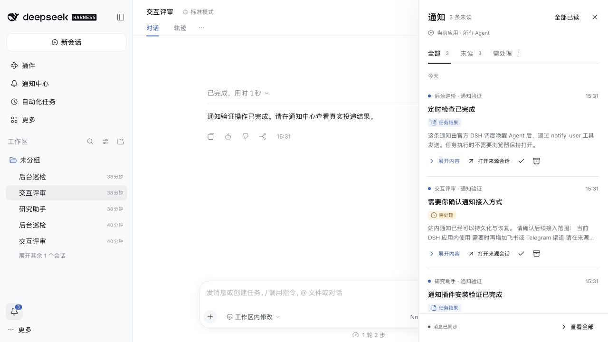

# DSH Agent Notify

让 Agent 主动发送消息，并在 DeepSeek Harness 的通知栏中查看、阅读和归档。

独立 DSH 插件，适配官方 **DSH 0.2.1-rc.3**，需要 **Node.js 24.9+**。界面包含铃铛未读角标、右侧通知抽屉、完整通知中心和通知设置；消息由真实 Agent 工具调用或可信宿主服务产生。



## 安装

在已有 Web profile 中安装：

```sh
dsh plugin --profile web add https://github.com/yawenzzz/dsh-agent-notify/releases/download/v0.1.0/yawenzzz-dsh-agent-notify-0.1.0.tgz
dsh --profile web
```

安装后重新启动目标 profile，左侧栏底部出现通知铃铛。若应用已在运行，请先让当前任务结束再重启。不要对已有 profile 执行初始化覆盖命令。

新 profile、无全局 DSH 和模型配置说明见 [安装与使用](docs/INSTALL.md)。

## 使用

让 Agent 在有结果时主动通知：

> 完成检查后，调用 notify_user，把结论发送到通知中心。

让官方调度在未来唤醒 Agent：

> 十分钟后检查结果；有需要关注的变化时调用 notify_user 通知我，没有变化就保持安静。

默认 Web 组合的官方调度会持久保存任务并恢复原 Session。应用进程需要保持运行；浏览器可以关闭。调度本身不保证业务任务仅执行一次。

通知工具接受：

```json
{
  "title": "研究报告已完成",
  "body": "已整理三个需要你确认的结论，请打开来源会话继续讨论。",
  "category": "result",
  "dedupe_key": "weekly-report:2026-10-28"
}
```

- `category`：`general` 普通、`result` 任务结果、`action` 需处理。
- 身份、工作区和来源会话由宿主绑定，模型不能指定另一个发送人。
- 同一调用或同一会话内的业务去重键重复提交时复用原记录；同键不同内容返回冲突。
- `queued` 表示已持久接收；`sent` 表示已进入站内通知中心，已读状态单独记录。

## 通知界面

- 铃铛旁显示未读数量，点击打开约 400px 宽的抽屉，窄屏使用全屏对话框。
- 支持全部、未读、需处理筛选，展开正文、打开来源会话、标为已读或未读、归档。
- 通知中心支持内容搜索、来源筛选、加载更多及查看归档。
- “全部已读”只标记当前显示快照中的消息，新到消息保持未读。
- 设置包括启用状态、弹出提示、静默时段、已读消息保留期、批量、并发和重试预算。
- “发送测试通知”是明确标注的手动测试消息，不冒充 Agent。

## 留存与恢复

消息和发件箱存储在 SQLite，路径为 `$DSH_HOME/agent-notify/<profile-scope>/`。单个 Host 独占写入锁，站内收件箱写入与发送确认在同一事务中提交。

重启后恢复未完成投递；失败仅重试已保存的消息，不重新执行模型。已读状态在宿主保存，多个页面共享。默认保留已读消息 90 天，未读和待投递消息不会自动清理；最多保存 5000 条通知，超限明确拒绝新消息。可将保留期设为永久。

一个 Host 中的所有 Agent 共用通知中心。不同 profile 或 RSI 项目进程各自独立，安装到管理端不会自动安装到其他项目。当前版本提供站内通知；飞书、Telegram、系统推送和跨 Host 汇总尚未接入。

采用官方插件接口，不修改 DSH 核心，不捆绑 DSH 运行时，也不依赖 RSI。可靠投递的设计参考 [nanobot 自动化文档](https://github.com/HKUDS/nanobot/blob/main/docs/automations.md)，插件由 TypeScript 独立实现。

## 开发与验证

```sh
npm ci
npm run typecheck
npm test
npm run build
npm run test:smoke
```

`test:smoke` 在干净临时 DSH home 中，通过官方 CLI 安装 tarball，执行真实 Agent 工具调用与官方定时任务，并验证重启、未读状态、配置持久化和权限。测试使用确定性的本地模型适配器，不调用付费模型；临时进程与目录会被清理。

本地试用：

```sh
node scripts/local-demo.mjs
```

它创建独立的 `~/.dsh-agent-notify-demo` 和 `notify-demo` profile，安装插件并启动官方 DSH。试用 profile 使用明确标注的集成测试模型，生成真实工具调用的验证消息；不是通用聊天模型。Ctrl+C 停止应用，通知数据保留。

设计与实现边界见 [DESIGN.md](DESIGN.md)。项目采用 [MIT 许可证](LICENSE)。
